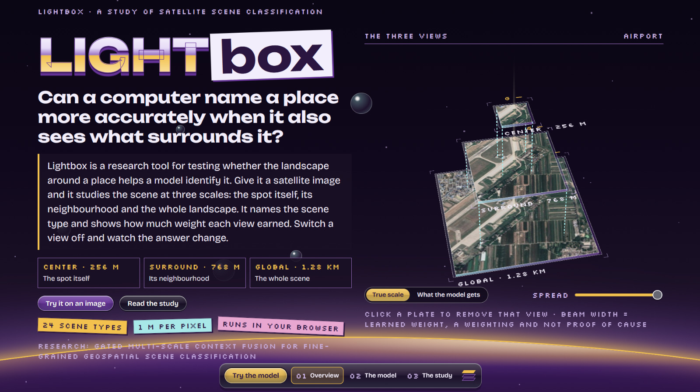
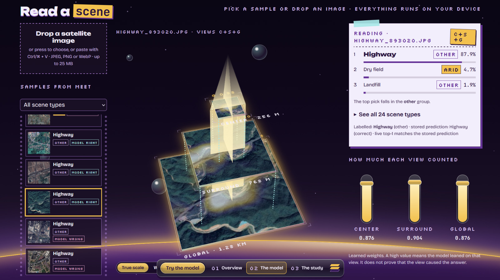

<div align="center">

# LIGHTBOX — Does the Neighbourhood Help Name the Place?

**Gated multi-scale context fusion for fine-grained satellite scene classification: three nested views of one scene, a learned gate per view, and an in-browser instrument where you switch views off and watch the answer change.**


[](https://arxiv.org/abs/2503.11219)


**[Live Demo](https://ktariqq.github.io/lightbox-scene-context/) · [Results Guide](results/README.md) · [Web App Notes](docs/README.md) · [Report a bug](../../issues)**



━━━━━━━━━━━━━━━━━━━━ ✦ ━━━━━━━━━━━━━━━━━━━━

</div>

## 🟣 At a Glance

- **A controlled question**: does adding surrounding context beat the center view alone, is the gain larger for arid classes, and does it hold on Sentinel-2 imagery of the UAE at 10 m per pixel?
- **Proposed model (B4-VD)**: frozen MobileNetV2 features for three views, a per-channel sigmoid gate for each view, and view dropout during training
- **Paired comparisons, three seeds**: B2 vs B3, B3 vs B4, B3-VD vs B4-VD, B3 vs B3-VD, B4 vs B4-VD. Every fusion variant is scored on all 7 view subsets
- **Honest statistics**: exact McNemar per seed with effect sizes, and a stratified paired bootstrap 95% CI on per-class context gain
- **Interpretable**: gate weights per sample, class and group, their correlation with correctness, and Grad-CAM per view
- **External test with a resolution control**: 93 manually reviewed Sentinel-2 samples across 9 UAE classes, plus MEET degraded to 10 m so resolution is separated from sensor and region
- **No test-set tuning**: keras-tuner uses validation macro-F1 only. Leakage is screened by exact MD5 and nearest-train feature similarity
- **Runs in your browser**: backbone and head execute in TensorFlow.js on GitHub Pages; nothing is uploaded
- **Reproducible**: pinned requirements, fixed seeds, one `run_all.sh`

<br/>

## 🟣 Overview

Fine-grained scene types such as quarry versus bare rock, or brownfield versus construction, can look alike up close. The MEET dataset gives every sample three nested views at 1 m per pixel, so the neighbourhood is available as context. Lightbox measures whether a model benefits from it and shows how much weight each view gets.

The study uses a balanced 24-class subset of MEET (200 train, 50 validation and 100 test images per class, sampled from the official split lists with seed 42) and a small UAE external set built from open Sentinel-2 imagery. Built by [@ktariqq](https://github.com/ktariqq) for AIRE410 Deep Learning at Abu Dhabi University.

<br/>

<div align="center"></div>

<br/>

<div align="center">━━━━━━━━━━━━━━ ✦ ✧ ✦ ━━━━━━━━━━━━━━</div>

<br/>

## 🟣 The Three Views

| View | Crop (px, of 1280) | Ground footprint | Role |
|---|---|---|---|
| **Center** | (512, 512, 768, 768) | 256 m | The spot itself; the label comes from here |
| **Surround** | (256, 256, 1024, 1024) | 768 m | Its neighbourhood |
| **Global** | full image | 1.28 km | The whole landscape |

Each view is resized to 224 x 224, so the network always receives the same number of pixels while each view covers a different amount of ground.

<br/>

## 🟣 Models Compared

| Model | Input | What it is | What it answers |
|---|---|---|---|
| Majority, Chance | n/a | Train-prior and random-logit baselines | Floor |
| **B1** | Center | Small CNN trained end to end | Reference only. Different architecture, so **not** a context comparison |
| **B2** | Center | Frozen MobileNetV2 + MLP head | The center-only control |
| **B3** | 3 views | Concatenation fusion | Does naive context help? |
| **B3-VD** | 3 views | B3 + view dropout | Does robustness to missing views help? |
| **B4** | 3 views | Gated fusion | Does learned weighting help? |
| **B4-VD** | 3 views | Gated fusion + view dropout | **Proposed** |

<br/>

## 🟣 The Experience

| Section | What it does |
|---|---|
| **Hero** | Three glass plates at true scale or as the model receives them, a spread slider, and click-to-remove for any view |
| **The model** | Pick a MEET sample or drop, paste or choose your own image. See the top three answers with an arid/other tag, all 24 on request, a fader per view showing its learned weight, and all 7 view subsets |
| **Add context step by step** | Center only, then plus surround, then plus global, with the answer and gates at each step |
| **Heat map** | Grad-CAM per view with opacity, a colour-blind-safe ramp and a choice of target class |
| **The study** | Four tabs: the questions, how it works, results and method |
| **Results** | View-subset ablation, McNemar tables, context gain with confidence intervals, UAE check, calibration, gates, a confusion map and a per-class explorer. Every chart has a table view |

<br/>

## 🟣 Method

**Features.** A frozen ImageNet MobileNetV2 reads each view and global-average-pools it to 1,280 numbers. Features are cached once, so heads train in minutes on a CPU.

**Gated head.** Each view is projected to 256 numbers (ReLU). A sigmoid gate per view and channel is computed from all projected views together. The fused vector is the masked mean over the active views of gate times projection, followed by a hidden layer and 24 logits. Because the mask is an input, one model scores any non-empty view subset.

**View dropout.** With probability `pfull` all three views are kept; otherwise one of the six smaller subsets is chosen at random.

**Tuning and training.** keras-tuner RandomSearch, 10 trials each for B3-VD and B4-VD, searching learning rate, widths, `pfull` and batch size, scored by macro-F1 on the full validation set. B3 and B4 reuse those settings with `pfull = 1`. B2 reuses B3-VD's learning rate and widths. Adam with cosine decay, up to 30 epochs, early stopping on patience 5. Seeds 42, 7 and 123 for every head.

**Metrics.** Accuracy, top-3, macro precision, recall, F1, ROC AUC, PR AUC, and ECE over 15 bins.

**Statistics.** Exact McNemar on paired test predictions per seed, with a practical-significance threshold on the accuracy difference. Context gain for a class is its score with all three views minus its score with the center only (B2), with a stratified paired bootstrap 95% CI. The arid grouping was fixed before any result was seen.

**UAE external set.** Candidate points come from OpenStreetMap (candidate generation only, at least 2.5 km apart, up to 15 per class). Each point gets the least-cloudy Sentinel-2 L2A scene in the window 2025-11-01 to 2026-03-31, a 128 x 128 px window at 10 m per pixel upsampled to MEET's frame and cut into the same three views. Labels come from manual visual review, not from OSM. No retraining or tuning on UAE. A class is scored only with at least 5 accepted samples.

**Resolution control.** MEET test views are degraded to 10 m (box downsample, bicubic upsample) so UAE changes can be split into resolution and everything else.

<br/>

## 🟣 Engineering Highlights

- **Stream, don't download**: `02_extract.py` reads only the sampled images from the remote MEET archives with HTTP range requests, with retries and a full-zip fallback for small classes
- **Leakage screens**: exact MD5 across splits and cosine similarity of each val/test sample to its nearest training sample
- **One mask-aware head**: the same weights score every view subset, in Python and in the browser
- **Parity-tested export**: a numpy forward pass is checked against Keras within 1e-3 on four masks, and the page can re-run the check
- **Every site number is read from `results/`**: missing files show an explicit state instead of invented values
- **Pinned and seeded**: `requirements.txt`, `requirements.lock.txt`, Python, NumPy and TF seeds set in every script
- **Static by design**: no backend, relative paths, auto-deployed from `main`
- **Accessible**: keyboard-operable plates and tabs, ARIA labels on charts with table equivalents, reduced-motion support

<br/>

## 🟣 Tech Stack

| Layer | Tools |
|---|---|
| Modelling | TensorFlow 2.16.2, Keras 3, keras-tuner 1.4.7 |
| Analysis | NumPy, pandas, SciPy, scikit-learn, matplotlib |
| Acquisition | huggingface_hub, remotezip, requests, rasterio (Sentinel-2 COGs via Element84 Earth Search), OpenStreetMap Overpass |
| Web | Vanilla ES modules, TensorFlow.js 4.22.0 (WebGL, WASM or CPU backend), CSS 3D plate stack, SVG charts |
| Typography | Unbounded, Bricolage Grotesque, JetBrains Mono, Silkscreen |
| Hosting | GitHub Pages via GitHub Actions |

<br/>

## 🟣 Pipeline

| Script | Purpose |
|---|---|
| `01_manifest.py` | Sample 24 classes from the official split lists; write the manifest and counts |
| `02_extract.py` | Stream the sampled images, cut the three views, record md5 and status |
| `03_audit.py` | Exact-duplicate and nearest-train similarity screens |
| `04_uae_candidates.py` | OSM candidates for the 16 classes resolvable at 10 m |
| `05_uae_fetch.py` | Fetch Sentinel-2 windows and scene metadata |
| `06_uae_review.py` | Offline review page: accept, reassign or reject each candidate |
| `07_uae_views.py` | Build UAE views for classes with at least 5 accepted samples |
| `08_meet10.py` | Degrade MEET test views to 10 m |
| `09_s2_summary.py` | Compare test, MEET-10m and UAE on the same classes |
| `features.py` | Cache frozen MobileNetV2 features per view and split |
| `train.py` | B1, tuning, and all heads over three seeds |
| `evaluate.py` | Metrics, McNemar, bootstrap context gain, calibration, efficiency |
| `explain.py` | Gate analysis and Grad-CAM gallery |
| `export_web.py`, `export.py` | Head weights, parity data, site data and gallery assets |

<br/>

## 🟣 Project Structure

```
lightbox-scene-context/
├── 01_manifest.py … 09_s2_summary.py   # data, UAE set and resolution control
├── features.py  train.py  evaluate.py  explain.py
├── export_web.py  export.py            # model and data for the site
├── models.py  common.py  config.py     # shared code and settings
├── classes.json                        # 24 classes and the arid grouping
├── run_all.sh                          # stage runner
├── subset_manifest.csv  uae_manifest.csv  subset_counts.csv
├── uae/                                # labels, candidates, scene metadata
├── results/                            # tables, figures, logs (see results/README.md)
├── docs/                               # the static site (see docs/README.md)
├── assets/                             # README screenshots
└── .github/workflows/deploy.yml
```

<br/>

## 🟣 Getting Started

Look at the site locally without retraining:

```bash
git clone https://github.com/ktariqq/lightbox-scene-context.git
cd lightbox-scene-context
mkdir -p docs/data && cp -r results docs/data/results
python -m http.server 8000 -d docs     # open http://localhost:8000/
```

Reproduce the study (use Git Bash or WSL on Windows):

```bash
python -m venv .venv && source .venv/bin/activate
pip install -r requirements.txt
./run_all.sh prep        # manifest, then fill the arid list in classes.json
./run_all.sh remote      # extraction and features; a Kaggle or Colab GPU session is faster
./run_all.sh audit
./run_all.sh uaetest && ./run_all.sh uaefetch   # then review uae/review_s2.html and save uae/labels.csv
./run_all.sh uaeviews && ./run_all.sh meet10
./run_all.sh train       # or train-fast for one default config
./run_all.sh report && ./run_all.sh web
```

<br/>

## 🟣 Data and Licences

| Source | Use | Terms |
|---|---|---|
| **MEET**, Hugging Face `zinStar/MEET` (Li et al., 2025) | Training, validation and test subset | Terms on the dataset card apply. MEET imagery is not redistributed here |
| **Copernicus Sentinel-2** via Element84 Earth Search | UAE external set | Free, full and open. *Contains modified Copernicus Sentinel data 2025, 2026.* Only aggregate UAE results are published |
| **OpenStreetMap** | UAE candidate generation only | © OpenStreetMap contributors, ODbL |
| **MobileNetV2** ImageNet weights | Frozen backbone | `keras.applications`; ImageNet terms apply |
| **TensorFlow.js** 4.22.0 | In-browser inference | Apache 2.0 |
| **Code** | This repository | MIT, see `LICENSE` |

<br/>

## 🟣 Limitations

- **Subset, not the benchmark**: 200 train images per class with a frozen backbone. Numbers are not comparable with the MEET paper's benchmark
- **No coordinates in MEET**: geographic overlap between splits cannot be checked; near-duplicates are screened by hash and feature similarity only
- **UAE coverage is thin**: 93 samples in 9 of 24 classes, one reviewer, no second-annotator check. Of the 8 arid classes only Mountain, Quarry and Scrub are covered, so the arid-versus-other comparison on UAE is weak
- **Different sensor**: Sentinel-2 at 10 m is ten times coarser than MEET. Five small-object classes cannot be sampled; Dry field, Hills and Military training ground were not sampled
- **B1 vs B2 says little about context**: different architectures
- **Gates are weights, not causes**, and Grad-CAM is a visual aid
- **Browser resampling** differs slightly from the Python pipeline; only the head is parity-tested

<br/>

## 🟣 Future Directions

Fine-tune the backbone instead of freezing it, scale to more of MEET, compare against an attention-based context model, extend the UAE set with a second annotator and more arid classes, and calibrate confidences for out-of-distribution imagery.

<br/>

## 🟣 Deployment

`deploy.yml` publishes `docs/` to GitHub Pages on every push to `main`, copying `results/` into the site first. It does not block on missing files, so check the Pages build and the site after each push. Set Settings → Pages → Source to **GitHub Actions**.

<br/>

## 🟣 References

- Y. Li et al., "MEET: A Million-Scale Dataset for Fine-Grained Geospatial Scene Classification with Zoom-Free Remote Sensing Imagery," arXiv:2503.11219, 2025.
- M. Sandler et al., "MobileNetV2: Inverted Residuals and Linear Bottlenecks," CVPR, 2018.
- R. Selvaraju et al., "Grad-CAM: Visual Explanations from Deep Networks via Gradient-based Localization," ICCV, 2017.
- Copernicus Sentinel-2 (ESA), Element84 Earth Search STAC, OpenStreetMap Overpass API.

<br/>
<br/>

<div align="center">

━━━━━━━━━━━━━━ ✦ ✧ ✦ ━━━━━━━━━━━━━━


</div>
